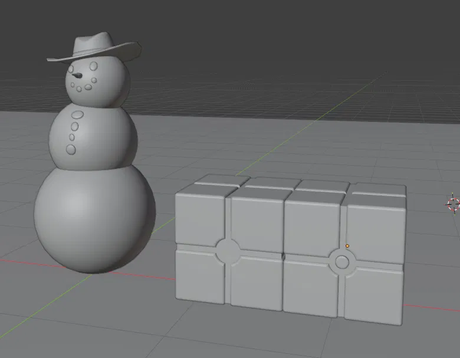

# Hard-Surface 3D Asset: Sci-Fi Crate

Praktikum Grafika Komputer Pertemuan 9 (EF234504): memodelkan satu hard-surface asset di Blender, mulai dari primitive dan blockout, Extrude, Inset, Loop Cut, Bevel, modifier, sampai cleanup topology.

## Identitas

- Kelompok: `Tim Unrendered` — Kelas `Grafika Komputer (B)`
- Anggota:
  - `Randi Palguna Artayasa` — `5025231020`
  - `Hikmia Sofia Nur Izzati` — `5025231147`



## Nama asset dan konsep

**Sci-Fi Crate**: peti sci-fi berbentuk kotak yang tersusun dari blok-blok identik. Antar blok ada celah panel yang rapi, dan di pusat sisi ada detail lingkaran: sudut-sudut blok yang bertemu di tengah terpotong melengkung mengikuti lingkaran, dengan tombol menonjol di tengahnya. Bentuk referensinya adalah kotak modular 4×2 dengan garis panel dan lingkaran di titik temu blok.

Ide utama desain:

- **Modular**: satu kubus 2×2×2 blok bisa dipanjangkan menjadi 4×2×2 hanya dengan Array Modifier.
- **Paneling**: celah antar blok dibuat seragam supaya tampak seperti panel logam yang disambung.
- **Bentuk terkontrol**: tepi blok dan disc diberi bevel, dan alur lingkaran dipotong dengan Boolean sehingga lengkungnya presisi mengikuti disc.

## Isi repository

```text
praktikum-hardsurface-blender-09/
├── P09_Kelompok9_SciFiCrate.blend   # file Blender
├── README.md
└── screenshots/                     # screenshot proses dan hasil akhir
    ├── 01-primitive-cube.png
    ├── 02-loop-cut.png
    ├── 03-loop-cut-celah-xray.png
    ├── 04-extrude-celah.png
    ├── 05-inset-lingkaran.png
    ├── 06-extrude-tombol.png
    ├── 07-bevel.png
    └── 08-array-final.png
```

## Cara membuka

1. Buka `P09_Kelompok9_SciFiCrate.blend` dengan Blender.
2. Semua data ada di dalam file `.blend`. Tidak ada texture atau file eksternal, dan belum ada UV maupun material (tahap berikutnya).
3. Modifier (Array dan Boolean) sengaja **tidak di-Apply**. Buka `Properties → Modifiers` untuk melihat dan mengubah parameternya.
4. Object disc dipakai sebagai cutter Boolean, jadi jangan dihapus dari scene.

## Primitive awal

| Primitive | Cara membuat | Dipakai untuk |
| --- | --- | --- |
| Cube | `Shift+A → Mesh → Cube` | Badan crate, titik awal blockout |
| Disc (Cylinder yang dipipihkan) | `Shift+A → Mesh → Cylinder` | Cutter Boolean untuk alur lingkaran, dan dasar tombol di pusat sisi |

Setelah blockout, scale diterapkan dengan `Ctrl+A → Scale` supaya scale object kembali `1, 1, 1`.

## Operasi modeling

| Kategori | Yang dilakukan |
| --- | --- |
| Mode | Object Mode untuk menata object dan modifier, Edit Mode untuk Vertex, Edge, dan Face Selection |
| Transform | `G`, `R`, `S` dengan axis constraint (`G → X`, `S → Z`, dan seterusnya), serta input numerik (contoh `G → X → 2`) |
| Apply Scale | `Ctrl+A → Scale` pada object yang diubah ukurannya |
| Loop Cut, Extrude, Inset, Bevel | Lihat tabel di bawah |

### Bagian yang memakai Extrude, Inset, Loop Cut, dan Bevel

| Operasi | Shortcut | Dipakai pada | Hasil |
| --- | --- | --- | --- |
| **Loop Cut** | `Ctrl+R` | Kubus: satu cut di tengah tiap sumbu (X, Y, Z), lalu dua cut rapat di tengah | Kubus terbagi menjadi 2×2×2 blok, dan strip tengah siap dijadikan celah |
| **Extrude** | `E` | Face strip tengah antar blok (ke dalam), dan bagian tengah disc (ke luar) | Celah panel antar blok, dan tombol yang menonjol |
| **Inset** | `I` | Face disc di pusat sisi | Cincin luar dan area tengah terpisah, menjadi dasar tombol |
| **Bevel** | `Ctrl+B` | Tepi blok dan tepi disc | Sudut membulat dan highlight halus, kesan kubus mentah hilang |

## Modifier

| Modifier | Parameter | Fungsi |
| --- | --- | --- |
| Array | Count `2`, sumbu X | Menggandakan kubus 2×2×2 menjadi 4×2×2, detail lingkaran ikut berulang |
| Boolean | Operation `Difference`, Operand Type `Object`, Object: disc | Memotong sudut-sudut blok yang bertemu di pusat sisi secara melengkung mengikuti lingkaran disc |

### Alur melingkar dengan Boolean Difference

Di pusat sisi, empat blok bertemu di sudutnya. Disc diletakkan tepat di titik temu itu sebagai cutter. Boolean Modifier dengan operation **Difference** mengurangi volume blok yang beririsan dengan disc, sehingga sudut keempat blok terpotong melengkung mengikuti lingkaran dan membentuk alur melingkar. Setelah itu disc dikerjakan dengan Inset dan Extrude menjadi tombol di tengah alur.

Karena Boolean dipakai sebagai modifier dan tidak di-Apply, posisi dan ukuran lingkaran bisa diubah kapan saja dengan menggeser atau men-scale object disc.

## Challenge yang dikerjakan

1. **Controlled curved form**: bentuk lengkung dibuat dengan terkontrol, bukan asal membulat. Bevel di tepi blok memakai lebar dan segmen yang sama di seluruh model supaya highlight konsisten. Alur melingkar dipotong dengan Boolean Difference mengikuti lingkaran disc, dan tombol yang menonjol di tengahnya memberi kontras lengkung terhadap blok yang lurus (lihat `07-bevel.png`).
2. **Repeated detail dengan Array**: Array Modifier memanjangkan kubus 2×2×2 menjadi 4×2×2 seperti render referensi. Detail lingkaran ikut berulang di tiap modul. Karena modifier tidak di-Apply, perubahan pada blok asal otomatis terbawa ke seluruh modul (lihat `08-array-final.png`).

## Cleanup

- **Duplicate vertex**: `Mesh → Clean Up → Merge by Distance`. Jumlah vertex di Statistics overlay dicek sebelum dan sesudah.
- **Geometry lepas**: `Mesh → Clean Up → Delete Loose` untuk vertex atau edge yang tidak terpakai.
- **Normal / facing**: overlay `Face Orientation` dinyalakan, seluruh face harus biru. Face merah diperbaiki dengan `Shift+N` (Recalculate Outside).
- **Silhouette**: dicek dari tampilan ortho Front, Right, dan Top (`Numpad 1`, `3`, `7`).
- **Detail tidak diperlukan**: edge loop yang tidak mengubah silhouette atau bevel dihapus dengan `Dissolve Edges`.
- **Scale**: `Ctrl+A → Scale` supaya scale object `1, 1, 1`.
- **File bersih**: object yang tidak berhubungan dengan asset dihapus, lalu `File → Clean Up → Purge Unused Data`.
- **Penamaan**: setiap object diberi nama jelas dan disusun rapi di Outliner.

File siap dilanjutkan ke tahap UV dan material.

## Dokumentasi proses

| No | Screenshot | Tahap | Isi |
| --- | --- | --- | --- |
| 1 | `01-primitive-cube.png` | Primitive | Cube default sebagai titik awal |
| 2 | `02-loop-cut.png` | Loop Cut | Satu loop cut per sumbu, kubus menjadi 2×2×2 |
| 3 | `03-loop-cut-celah-xray.png` | Loop Cut (X-ray) | Dua loop cut rapat di tengah tiap sumbu sebagai calon celah |
| 4 | `04-extrude-celah.png` | Extrude | Strip tengah di-extrude ke dalam, blok terpisah oleh celah |
| 5 | `05-inset-lingkaran.png` | Boolean + Inset | Sudut blok terpotong melengkung mengikuti disc, disc di-inset sebagai dasar tombol |
| 6 | `06-extrude-tombol.png` | Extrude | Tombol di tengah lingkaran menonjol keluar |
| 7 | `07-bevel.png` | Bevel | Tepi blok dan disc membulat, shading smooth |
| 8 | `08-array-final.png` | Modifier + hasil akhir | Array memanjangkan crate menjadi 4×2 |

## Kendala dan solusi

| Kendala | Solusi |
| --- | --- |
| Bingung membuat lingkaran di tengah sisi blok | Disc dibuat dari primitive terpisah, diletakkan di titik temu keempat blok, lalu dipakai sebagai cutter Boolean Difference untuk memotong sudut blok. Tombol di tengahnya dikerjakan dengan Inset, Extrude, dan Bevel |
| Konsep Mirror dan peran origin belum dipahami | Dicoba dulu pada kubus kecil. Origin dipindah ke pusat kubus (`Shift+S → Cursor to Selected`, lalu `Object → Set Origin → Origin to 3D Cursor`) supaya bidang cermin tepat di tengah celah |