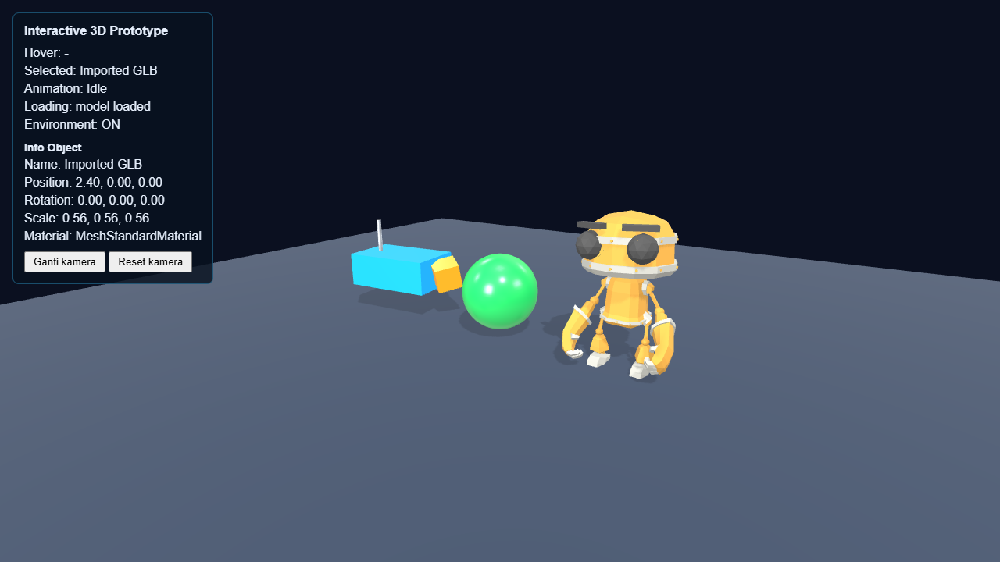

# Three.js Interactive 3D Prototype

Praktikum Grafika Komputer Pertemuan 7: mengembangkan mini scene Pertemuan 6 menjadi aplikasi 3D interaktif dengan scene graph, material PBR, model GLB beranimasi, raycasting (hover dan click), selection state, dan environment map.

## Identitas

- Kelompok: `Tim Unrendered` — Kelas `Grafika Komputer (B)`
- Anggota:
  - `Randi Palguna Artayasa` — `5025231020`
  - `Hikmia Sofia Nur Izzati` — `5025231147`



## Deskripsi aplikasi

Scene berisi tiga object interaktif di atas ground: demo hierarchy parent-child (box biru dengan child box oranye dan antena), bola PBR hijau, dan model robot GLB yang menjalankan animation clip. Ketiganya bisa di-hover dan diklik. Object yang di-hover membesar 1.06×, object yang dipilih membesar 1.12×, dan HUD menampilkan nama object yang di-hover, object terpilih, beserta informasinya.

## Cara menjalankan

Seperti Pertemuan 6, project ini memakai import map ke CDN (bagian 39.1 modul), jadi tidak perlu `npm install`. Jalankan static server di folder project:

```bash
python -m http.server 8000
```

Lalu buka `http://localhost:8000`. Bisa juga memakai Live Server.

Struktur project:

```
├── index.html          # import map Three.js + HUD
├── favicon.svg
├── screenshot.png
├── models/
│   └── model.glb
└── src/
    ├── main.js
    └── style.css
```

## Kontrol

| Kontrol | Fungsi |
| --- | --- |
| Drag kiri / drag kanan / scroll | Orbit / pan / zoom |
| Klik object | Memilih object (klik di ruang kosong membatalkan pilihan) |
| `1` `2` `3` | Clip Idle / Walking / Running |
| `E` | Environment ON/OFF |
| Tombol Ganti kamera | Perspective ↔ Orthographic |
| Tombol Reset kamera | Kembali ke PerspectiveCamera, posisi dan target awal |

## Struktur scene graph

```
Scene
├── AmbientLight
├── DirectionalLight
├── Ground
├── Hierarchy Demo (Group)
│   └── Body
│       ├── Child Object
│       └── Antenna
├── PBR Sphere
└── Imported GLB
    └── RobotArmature → bone + mesh
```

## Hierarchy parent-child

- `hierarchyGroup` (`THREE.Group`): position x `-2.5`, rotation y `π/6` (terus bertambah 0.25 rad/s), scale `1.1`.
- `body` adalah child dari group.
- `child` adalah child dari `body` dengan posisi lokal `(1, 0, 0)` dan rotasi lokal z `π/4`.
- `antenna` adalah child kedua dari `body`, sehingga group berisi tiga mesh.

Saat halaman dibuka, Console mencetak `Child local` dan `Child world`. Posisi lokal child tetap `(1, 0, 0)`, tetapi posisi world-nya berbeda karena dipengaruhi translation, rotation, dan scale parent:

```
matrixWorld(child) = matrixWorld(group) × matrix(body) × matrix(child)
```

## Model GLB

| | |
| --- | --- |
| File | `models/model.glb` |
| Model | RobotExpressive |
| Sumber asset | [three.js examples](https://github.com/mrdoob/three.js/tree/r170/examples/models/gltf/RobotExpressive), dibuat oleh Tomás Laulhé (Quaternius), lisensi CC0 1.0 |
| Transform | position `(2.4, 0, 0)`, scale `0.5` |

Model dimuat dengan `GLTFLoader`. Karena loading bersifat asynchronous, semua logic yang butuh model ada di dalam callback. HUD `Loading` menampilkan `loading model...`, persen progres, lalu `model loaded` (atau `load failed`). `traverse()` dipakai untuk mencetak nama dan tipe setiap object ke Console serta mengaktifkan `castShadow` dan `receiveShadow` pada semua mesh.

## Animation clip

Model memiliki 14 clip: Dance, Death, Idle, Jump, No, Punch, Running, Sitting, Standing, ThumbsUp, Walking, WalkJump, Wave, Yes. Clip yang dijalankan saat awal adalah **Idle**, memakai `AnimationMixer`, `clipAction()`, `play()`, dan `mixer.update(delta)` di animation loop.

## PBR material

Semua object memakai `MeshStandardMaterial`.

| Object | Roughness | Metalness |
| --- | --- | --- |
| Ground | 0.85 | 0.0 |
| Body | 0.45 | 0.15 |
| Child Object | 0.3 | 0.1 |
| Antenna | 0.2 | 1.0 |
| PBR Sphere | 0.25 | 0.1 |

- **Roughness**: 0 sangat halus (highlight kecil dan tajam), 1 sangat kasar (highlight menyebar).
- **Metalness**: 0 non-metal, 1 metal. Material metal sangat bergantung pada environment untuk pantulannya.

## Interaction

- **Raycasting**: pointer dikonversi ke NDC memakai `getBoundingClientRect()` canvas, lalu `raycaster.setFromCamera()` dan `intersectObjects(interactiveObjects, true)`. Hasil hit dipetakan ke selectable root dengan `findSelectableRoot()`.
- **Hover feedback**: scale 1.06 dan HUD `Hover`.
- **Click feedback**: scale 1.12, HUD `Selected`, dan info object. Selection tetap tersimpan walau pointer berpindah.
- **Click vs drag**: memakai pola `selectionGesture` / `suppressSelection` dari bagian 39.1, jadi drag kamera tidak mengubah selection.

## Environment

`RoomEnvironment` diproses `PMREMGenerator` lalu dipasang sebagai `scene.environment`. `scene.background` tetap warna `0x0b1020`, sehingga terlihat bedanya: background hanya latar, sedangkan environment dipakai material untuk reflection dan lighting.

## Challenge yang dikerjakan

1. **A — Multiple Animation Clips**: tombol `1` Idle, `2` Walking, `3` Running. Action lama di-`fadeOut()` dan action baru di-`fadeIn()`, semuanya dari satu `AnimationMixer`.
2. **C — Information Panel**: saat object dipilih, HUD menampilkan Name, Position, Rotation, Scale, dan Material Type. Untuk imported model, yang ditampilkan adalah label root `Imported GLB`.
3. **H — Environment Toggle**: tombol `E` mengganti `scene.environment` antara environment map dan `null`, dan HUD menampilkan `Environment: ON/OFF`.

## Catatan debugging

- Hit raycast pada robot mengembalikan mesh anak, bukan `gltf.scene`. `findSelectableRoot()` menelusuri `parent` sampai menemukan object dengan `userData.selectable`.
- Dengan kode hover dari modul, saat pointer keluar dari object yang sedang dipilih, `restoreScale()` mengembalikan scale-nya ke 1.0 sehingga feedback selection hilang. Setelah `restoreScale()`, `applyVisualState()` dipanggil lagi untuk object lama agar object terpilih kembali ke 1.12.
- `THREE.Clock` di Three.js r186 menampilkan warning deprecated di Console, jadi animation loop memakai `THREE.Timer` seperti Pertemuan 6. Delta tetap dibatasi maksimal 0.05 detik.
- Path model memakai `./models/model.glb` (relatif), bukan `/models/model.glb`, agar tetap bisa dibuka di GitHub Pages yang berada di subfolder repo (sama seperti Pertemuan 6).
