# Lighting, Camera & Rendering: Sci-Fi Crate

Praktikum Grafika Komputer Pertemuan 11: lighting, camera, HDRI, dan render engine untuk menghasilkan product-style hero render dari asset P9–P10.

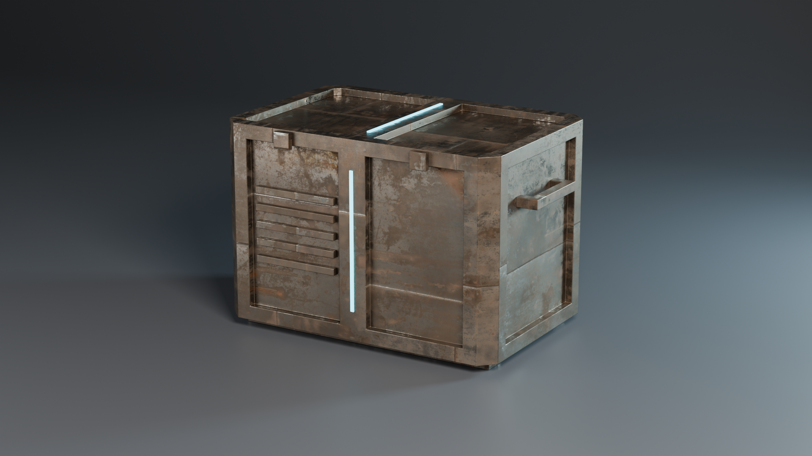

## Identitas

- Kelompok: `Tim Unrendered` (Kelompok 9) — Kelas `Grafika Komputer (B)`
- Anggota:
  - `Randi Palguna Artayasa` — `5025231020`
  - `Hikmia Sofia Nur Izzati` — `5025231147`
- Asset: **Sci-Fi Crate**. Crate logam hasil modeling P9, diberi UV dan material PBR di P10 (Metal Plate 02, Poly Haven CC0), dengan garis lampu emission berwarna cyan.

## Berkas

```
praktikum-lighting-render-blender-11/
├── P11_Kelompok9_SciFiCrate.blend   file P11, terpisah dari file P10
├── environment/
│   └── studio_small_09_2k.hdr       HDRI, path relatif
├── textures/                        4 texture PBR dari P10, path relatif
├── renders/                         render utama + gambar perbandingan
│   └── raw/                         render tunggal tiap eksperimen
└── README.md
```

File `.blend` disimpan dalam kondisi final: Cycles, `Hero_Camera`, HDRI rotasi 180°. Lampu studi (`TEST_*`) masih ada di collection `Lights_Study`, tapi disembunyikan. Semua render dibuat di Blender 5.4 dengan GPU NVIDIA RTX 4050 Laptop (OptiX).

Isi scene di Outliner:

| Collection | Isi |
| --- | --- |
| `Asset` | `SciFi_Crate` |
| `Studio` | `Ground`: lantai yang melengkung menjadi dinding (cyclorama), 30 × 12 m, radius lengkung 3 m, abu-abu gelap, Roughness 0.55 |
| `Lights_Study` | `TEST_Point`, `TEST_Sun`, `TEST_Spot`, `TEST_Area` |
| `Lights_ThreePoint` | `Key_Light`, `Fill_Light`, `Rim_Light` |
| `Cameras` | `Hero_Camera`, `Detail_Camera`, `DOF_Focus` |

## Persiapan scene

- File P10 dibuka lalu disimpan sebagai file P11 baru, sehingga file P10 tidak tertimpa. Texture disalin ke `textures/` dan path-nya dibuat relatif.
- Asset dicek ulang: scale 1, tidak ada texture yang missing, kedua material (`Crate_Metal`, `Crate_Glow`) aktif. Alas crate tepat di z = 0, jadi tidak menembus lantai.
- Point Light bawaan file P10 dihapus. Object diberi nama dan dikelompokkan per collection.
- Ground dibuat sebagai **cyclorama**: lantai yang melengkung ke atas menjadi dinding. Garis horizon tidak terlihat, sehingga latar terlihat seperti studio foto produk. Warnanya gelap supaya highlight logam dan rim light lebih menonjol.

## Lighting

### Studi empat jenis light

Setiap studi hanya memakai satu lampu. HDRI diturunkan ke 0.08 supaya karakter lampunya terlihat jelas.

| Light | Pengaturan | Karakter | Cocok untuk |
| --- | --- | --- | --- |
| Point | 600 W, Radius 0.02 m vs 0.8 m | Memancar ke segala arah dari satu titik. Radius kecil membuat tepi bayangan tajam, radius besar membuat bayangannya melebar dan lembut | Lampu kecil, bohlam, sumber lokal |
| Sun | Strength 4, Angle 0.5° vs 20°, datang rendah dari kiri | Cahaya sejajar: yang menentukan rotasi, bukan posisi. Angle kecil memberi bayangan panjang yang tegas. Angle besar membuat bayangan makin kabur semakin jauh dari crate | Outdoor, matahari, cahaya dari jauh |
| Spot | 1500 W, Spot Size 35°, Blend 0 vs 0.9 | Cahaya berbentuk kerucut. Blend 0 meninggalkan lingkaran batas yang keras di lantai. Blend 0.9 meredupkan tepinya secara halus seperti vignette | Fokus dramatis, lampu panggung |
| Area | 500 W, Size 0.1 m vs 3 m | Bidang cahaya. Size kecil memberi bayangan tajam dan highlight kecil. Size besar memberi bayangan lembut dan pantulan lebar di logam | Studio dan product render |

| Point: radius | Sun: angle |
| --- | --- |
| 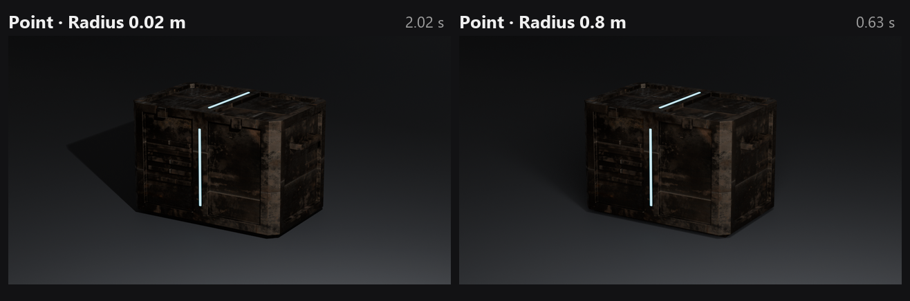 | 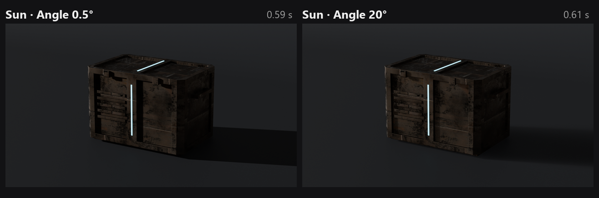 |
| **Spot: blend** | **Area: size** |
| 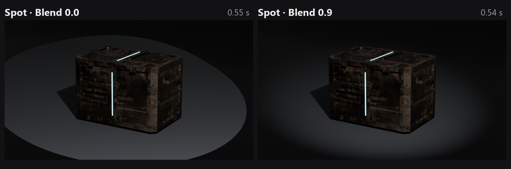 | 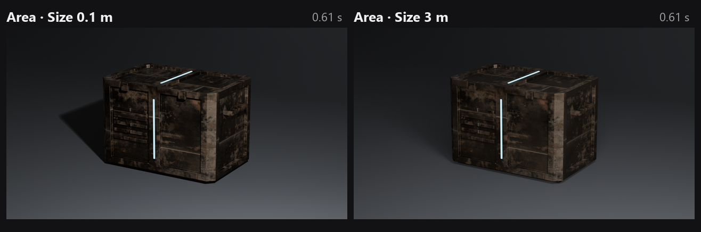 |

Tidak ada light yang "terbaik". Untuk crate logam di studio, Area light paling cocok: pantulannya lebar dan bayangannya lembut. Karena itu ketiga lampu utama memakai Area.

### Three-point lighting

| Light | Tipe | Posisi | Power | Size | Warna | Fungsi |
| --- | --- | --- | --- | --- | --- | --- |
| `Key_Light` | Area (persegi panjang) | Depan-kanan, tinggi 2.6 m | 600 W | 1.5 × 1.2 m | Hangat ringan (1, 0.95, 0.88) | Membentuk crate: menerangi tutup dan sisi kanan |
| `Fill_Light` | Area | Depan-kiri, rendah (1.1 m) | 180 W | 2.5 m | Dingin ringan (0.88, 0.94, 1) | Membuka bayangan di muka depan tanpa menghapusnya |
| `Rim_Light` | Area | Belakang-kanan, rendah (1.1 m) | 350 W | 0.6 m | Cyan (0.55, 0.85, 1) | Highlight di tepi kanan, memisahkan siluet dari backdrop |

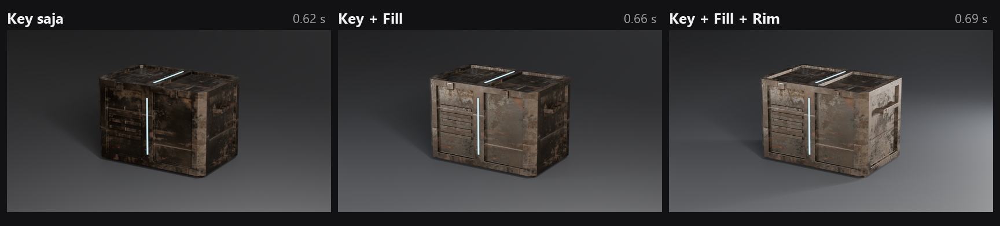

**Rasio Key/Fill.** Fill sama kuat dengan Key (A) membuat crate terlihat flat dan bayangannya hilang. Fill 20 W (C) membuat muka depan hampir hitam: dramatis, tapi detail karat hilang. Kami memilih **B (180 W, sekitar 3:1)**: bayangan masih memberi kedalaman dan detail di bagian gelap tetap terbaca.

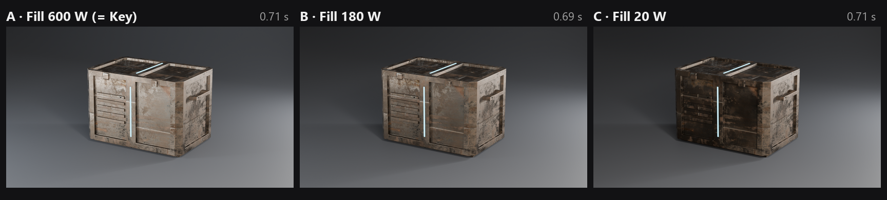

**Rim OFF vs ON.** Tanpa rim, tepi kanan crate menyatu dengan backdrop gelap. Dengan rim, rangka sisi kanan dan pegangan mendapat highlight tipis, sehingga siluetnya terpisah dari latar.

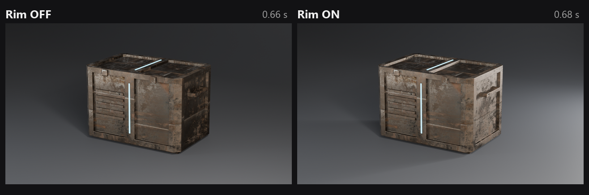

**Warna lampu.** Dengan semua lampu putih, warnanya netral tapi kurang hidup. Pada setup final, Key hangat, Fill dingin, dan Rim cyan. Karat logam tetap terlihat natural, dan rim cyan menyambung dengan warna garis emission.

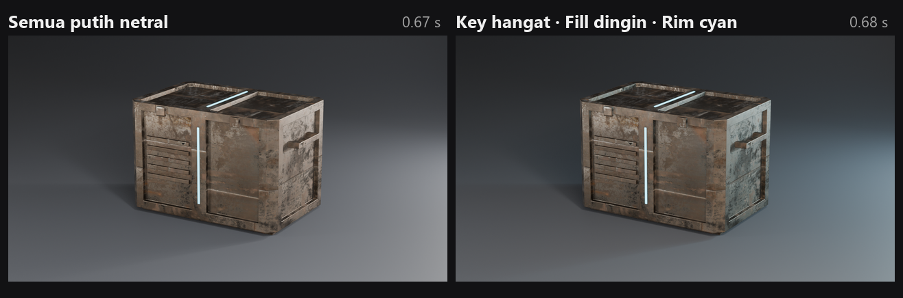

**Alasan lighting final:** Key dari depan-kanan atas memperlihatkan volume crate dan tekstur tutupnya. Fill rendah dari depan-kiri menjaga muka depan tetap terbaca dengan kontras sedang. Rim rendah dari belakang-kanan menegaskan siluet tanpa menyilaukan permukaan atas.

Posisi rim sempat kami ubah. Awalnya rim diletakkan di belakang-kiri atas, dan posisi itu ternyata tepat berada di arah pantulan cermin permukaan atas ke kamera. Akibatnya tutup crate jadi putih dan lantai ikut terang.

## Camera

### Composition

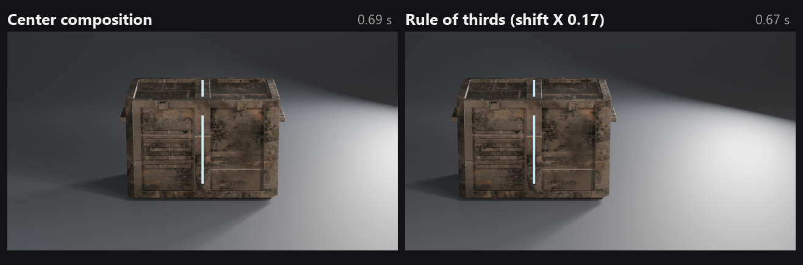

- **Center:** crate dilihat dari depan dan berada di tengah frame. Kesannya stabil, formal, dan teknis.
- **Rule of thirds:** kamera yang sama, Shift X 0.17, sehingga crate jatuh di garis sepertiga kiri. Ruang kosong di kanan sengaja disisakan sebagai negative space.
- **Hero:** dipilih sudut **3/4 sedikit dari atas** dengan crate di tengah. Menurut kami ini paling cocok untuk product shot: tiga sisi crate (muka depan, sisi kanan, dan tutup) terlihat sekaligus, dan ruang kosong di sekelilingnya seimbang.

### Camera angle

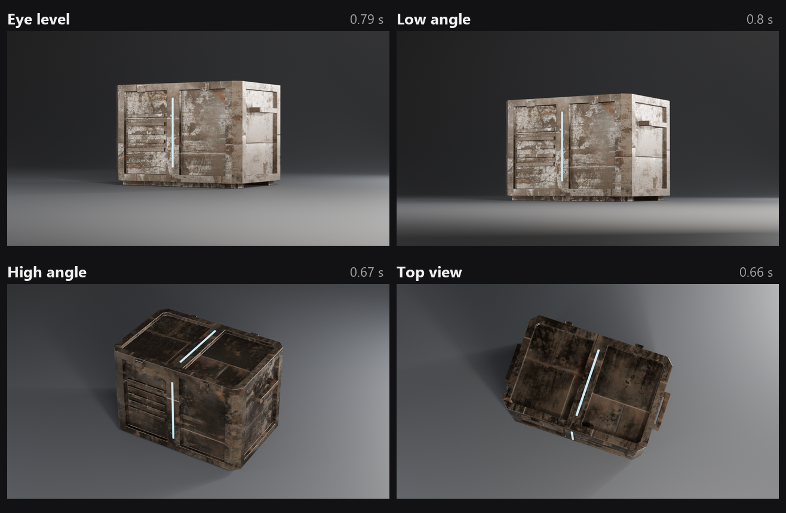

| Angle | Pengamatan |
| --- | --- |
| Eye level | Proporsi paling jujur, tapi tutup crate dan garis lampunya tidak terlihat. Crate tampak seperti fasad datar |
| Low angle | Crate terlihat lebih besar dan dominan. Lengkungan backdrop mulai terlihat sebagai garis terang di belakang |
| High angle | Tutup dan garis lampu terlihat jelas. Informasi bentuk paling banyak, tapi crate terasa lebih kecil |
| Top view | Cocok untuk melihat layout tutup, tapi muka depan dengan panel dan ventilasi hilang |

**Angle final:** 3/4 dengan elevasi sedikit di atas crate, di antara eye level dan high angle. Muka depan, sisi kanan, dan tutup terlihat sekaligus tanpa membuat crate terlihat kecil.

### Focal length

Saat focal length diganti, kamera digeser maju atau mundur (jarak = 7.6 m × focal / 85) supaya ukuran crate di frame tetap sama.

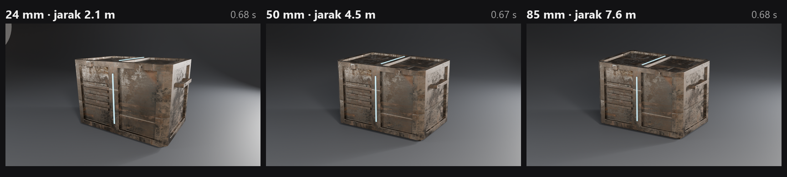

| Focal length | Jarak | FOV | Distorsi perspektif | Kesan | Cocok untuk asset? |
| --- | --- | --- | --- | --- | --- |
| 24 mm | 2.1 m | Lebar (~74°) | Kuat: sudut terdekat membesar, rangka vertikal menyempit ke bawah | Dekat dan dinamis. Ruang terasa luas, sampai batas cahaya Fill di lantai kiri ikut masuk frame | Kurang: crate tampak terdistorsi |
| 50 mm | 4.5 m | Sedang (~40°) | Moderat | Natural, seperti mata | Cukup |
| 85 mm | 7.6 m | Sempit (~24°) | Paling kecil: sisi crate hampir sejajar, perspektif terkompresi | Rapi dan "katalog" | **Dipilih untuk hero** |

### Depth of Field

- `Hero_Camera` memakai **Focus Object = `DOF_Focus`**, sebuah Empty di tengah muka depan crate. Titik fokus bisa dipindah dengan menggeser Empty-nya.
- Untuk eksperimen, kamera didekatkan ke sudut terdekat crate. Dari jarak hero (7.6 m) dengan backdrop polos, blur hampir tidak terlihat.
- **f/1.4:** sudut dekat tajam, sisi kiri yang jauh blur kuat. Mata langsung tertuju ke sudut fokus, tapi detail karat di sisi jauh hilang.
- **f/5.6:** hampir seluruh crate tajam, dengan sedikit pelembutan di sisi jauh.
- **Hero:** f/5.6. Backdropnya polos, jadi blur kuat tidak menambah apa-apa dan malah menyembunyikan material. DOF dipakai tipis saja untuk memberi kedalaman.

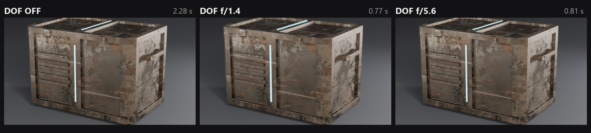

## HDRI

- **HDRI:** [Studio Small 09](https://polyhaven.com/a/studio_small_09) dari Poly Haven (CC0), 2K, disimpan di `environment/`.
- **Node World:** `Texture Coordinate (Generated) → Mapping → Environment Texture → Background → World Output`. Rotasi diatur lewat Rotation Z pada Mapping.
- **Orientasi:** pada rotasi 0°, softbox utama datang dari belakang-kanan dan bayangan jatuh ke depan-kiri. Muka depan crate gelap. Pada **rotasi 180°**, softbox datang dari belakang-kiri: tutup dan muka depan mendapat pantulan lebih terang, dan bayangan jatuh ke depan-kanan. Kami memilih **180°** karena HDRI jadi seperti backlight kedua yang melengkapi Key dari depan-kanan, dan tekstur tutup lebih terbaca.

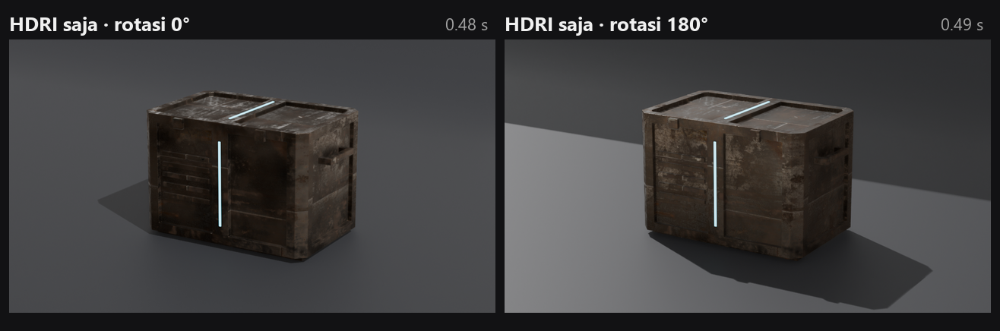

- **HDRI + lampu tambahan:** dengan Strength 1.0, HDRI ditambah tiga lampu membuat crate terlalu terang dan kontras turun, karena bayangan dari Key tertutup cahaya environment. Strength diturunkan ke **0.25**: HDRI tetap memberi pantulan realistis di logam, sementara arah cahaya utama tetap ditentukan Key, Fill, dan Rim.

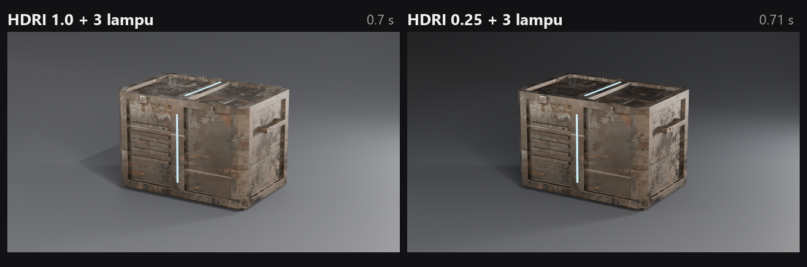

## Render

### EEVEE vs Cycles

Kedua render memakai asset, kamera (85 mm, f/5.6), lampu, HDRI (0.25, 180°), dan resolusi 1280 × 720 yang sama. Hanya render engine-nya yang berbeda.

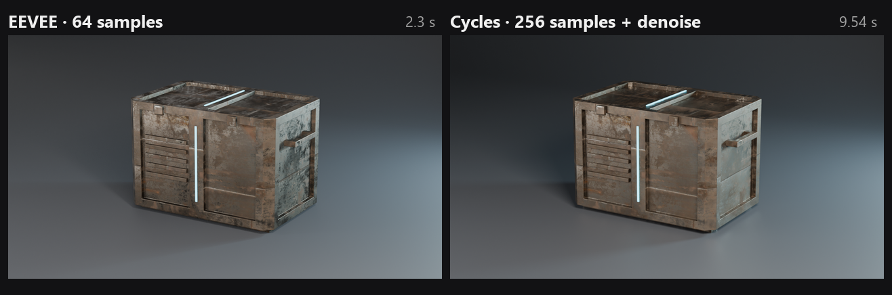

| Aspek | EEVEE (64 samples) | Cycles (256 samples + denoise) |
| --- | --- | --- |
| Render time | ±0.7 s (2.3 s pada render pertama karena compile shader) | 9.5 s |
| Noise | Tidak ada | Tidak ada setelah denoise |
| Shadow | Lebih tipis dan kurang menempel di bawah crate | Bayangan kontak di bawah crate lebih pekat dan natural |
| Reflection | Pantulan logam sudah bagus, tapi lebih datar | Pantulan logam dan karat lebih berlapis |
| Indirect lighting | Terbatas, backdrop agak kebiruan dan rata | Pantulan cahaya dari lantai ke crate terasa, gradasi backdrop lebih dalam |
| Material appearance | Karat sedikit lebih pucat | Karat dan logam lebih kontras |
| Responsiveness | Real-time di viewport | Butuh beberapa detik per frame |
| Kualitas akhir | Cukup untuk preview dan iterasi | **Dipilih untuk hero** |

Alur kerja kami: semua eksperimen lighting, kamera, DOF, dan HDRI dirender dengan EEVEE (sekitar 0.7 s per gambar). Cycles baru dipakai setelah komposisi dan lighting final.

### Sampling dan denoising

Render Cycles 1280 × 720 di GPU OptiX, scene dan kamera sama. Gambar di bawah adalah crop yang diperbesar 2× pada muka depan crate.

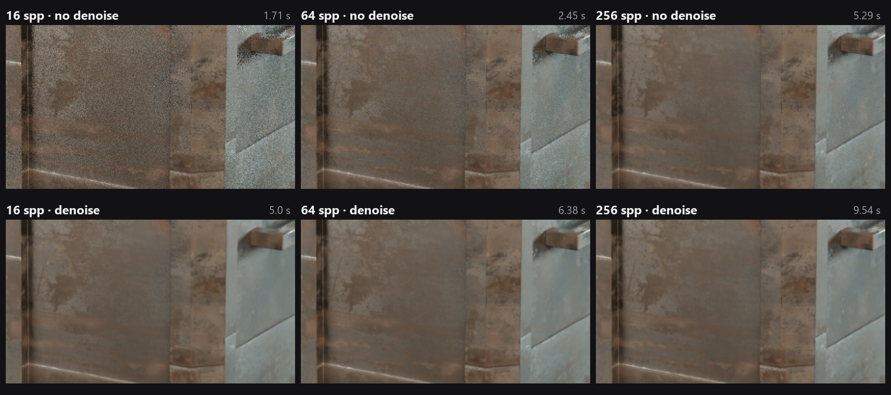

| Samples | Denoise | Waktu | Noise / kualitas |
| --- | --- | --- | --- |
| 16 | Off | 1.7 s | Noise kasar, terutama di bagian logam yang glossy |
| 64 | Off | 2.5 s | Masih berbintik halus |
| 256 | Off | 5.3 s | Hampir bersih, sisa noise tipis di bagian gelap |
| 16 | On | 5.0 s | Bersih, tapi detail karat terlihat terlalu halus seperti dicat |
| 64 | On | 6.4 s | Bersih dan detail tetap terjaga. Kompromi terbaik |
| 256 | On | 9.5 s | Paling bersih, dipakai untuk hero |

Denoiser (OpenImageDenoise) menambah sekitar 3 detik per render. Denoise juga bukan pengganti sample: pada 16 samples, noise memang hilang, tapi ikut menghapus detail texture. Kombinasi yang wajar adalah sample sedang ditambah denoise.

**Render time dan device.** Percobaan pertama, Cycles ternyata berjalan di CPU (Ryzen 7 7840HS) dan butuh **106.8 s** untuk 256 samples. Setelah device diganti ke **GPU OptiX (RTX 4050)**, waktunya turun ke **15.1 s** termasuk memuat kernel, dan **9.5 s** untuk render berikutnya.

### Engine final

**Cycles**, 256 samples, denoise On, 1920 × 1080, GPU OptiX: **20.7 s**.

## Challenge

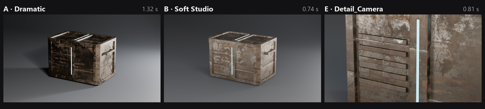

1. **Challenge A: Dramatic Lighting.** Key dibuat kecil (0.6 × 0.5 m) dan kuat (900 W), Fill hampir mati (8 W), Rim kecil dan terang (800 W), HDRI 0.03. Kontrasnya jauh lebih tinggi: muka depan hampir gelap, sementara tutup dan tepi kanan menyala. Crate tetap terbaca dari siluet dan garis lampu cyan. ([render](renders/challenge_A_dramatic.png))
2. **Challenge B: Soft Studio Lighting.** Key 4 × 3 m, Fill 4 m (300 W), Rim 3 m (350 W), HDRI 0.35. Bayangan sangat lembut, pantulan di logam lebar dan rata. Hasilnya mirip foto katalog: semua sisi terbaca, meskipun kesan volumenya lebih lemah dari setup final. ([render](renders/challenge_B_soft.png))
3. **Challenge E: Two-Camera Story.** `Hero_Camera` (85 mm, f/5.6) memperlihatkan crate secara utuh. `Detail_Camera` (100 mm, jarak 2.4 m, f/2.8) fokus ke garis lampu emission dan ventilasi di muka depan, sementara rangka di sekitarnya blur. Detail kecil yang tidak terbaca di hero shot jadi terlihat. ([render](renders/challenge_E_detail_camera.png))

## Dokumentasi

| No | Dokumentasi | File |
| --- | --- | --- |
| 01 | Point Light Study | [`light_point.png`](renders/light_point.png) |
| 02 | Sun Light Study | [`light_sun.png`](renders/light_sun.png) |
| 03 | Spot Light Study | [`light_spot.png`](renders/light_spot.png) |
| 04 | Area Light Study | [`light_area.png`](renders/light_area.png) |
| 05 | Three-Point Lighting | [`three_point.png`](renders/three_point.png), [`lighting_ratio.png`](renders/lighting_ratio.png), [`rim_compare.png`](renders/rim_compare.png), [`light_color.png`](renders/light_color.png) |
| 06 | Center Composition | [`raw/comp_center.png`](renders/raw/comp_center.png) |
| 07 | Alternative Composition | [`raw/comp_thirds.png`](renders/raw/comp_thirds.png) |
| 08 | Camera Angles | [`camera_angles.png`](renders/camera_angles.png) |
| 09 | Focal Length 24 mm | [`focal_24.png`](renders/focal_24.png) |
| 10 | Focal Length 50 mm | [`focal_50.png`](renders/focal_50.png) |
| 11 | Focal Length 85 mm | [`focal_85.png`](renders/focal_85.png) |
| 12 | DOF | [`dof.png`](renders/dof.png) |
| 13 | HDRI | [`hdri_rotation.png`](renders/hdri_rotation.png), [`hdri_lights.png`](renders/hdri_lights.png) |
| 14 | EEVEE | [`render_eevee.png`](renders/render_eevee.png) |
| 15 | Cycles | [`render_cycles.png`](renders/render_cycles.png) |
| 16 | Sampling / Denoising Study | [`sampling_denoise.png`](renders/sampling_denoise.png) |
| 17 | Final Hero Render | [`hero_final.png`](renders/hero_final.png) |

## Refleksi

| Kendala | Solusi |
| --- | --- |
| Pada lensa 24 mm, ujung backdrop terlihat dan HDRI studio muncul di belakangnya | Backdrop diperbesar (30 × 12 m, dinding 10 m) dan dinding digeser lebih ke belakang |
| Rim di belakang-kiri atas membuat tutup crate putih dan lantai ikut terang | Rim dipindah ke belakang-kanan dengan posisi rendah dan diperkecil, jadi hanya mengenai tepi crate |
| Fill di samping hampir tidak berpengaruh pada crate logam | Fill dipindah ke depan-kiri dengan posisi rendah dan diperbesar (2.5 m), sehingga muka depan memantulkan cahayanya |
| Bayangan Sun jatuh di belakang crate, jadi perbedaan angle tidak terlihat | Sun dibuat datang rendah dari samping kiri, sehingga bayangannya jatuh ke kanan dan terlihat kamera |
| DOF tidak terlihat dari jarak hero karena backdrop polos | Eksperimen DOF memakai framing lebih dekat dengan fokus di sudut terdekat crate |
| Cycles memakan 106.8 s karena berjalan di CPU | Device diganti ke GPU OptiX: 9.5 s |
| Pada lensa 24 mm, batas jangkauan cahaya Fill (Area light hanya memancar ke depan) ikut masuk frame | Dicatat sebagai karakter lensa lebar. Hero memakai 85 mm, sehingga batas ini tidak terlihat |

Pelajaran terbesar dari praktikum ini: setiap kali hanya mengubah satu variabel (rasio fill, posisi rim, atau rotasi HDRI) membuat penyebab perubahan di render mudah dipahami. EEVEE membuat iterasi semacam ini murah, dan Cycles cukup dipakai di akhir.
