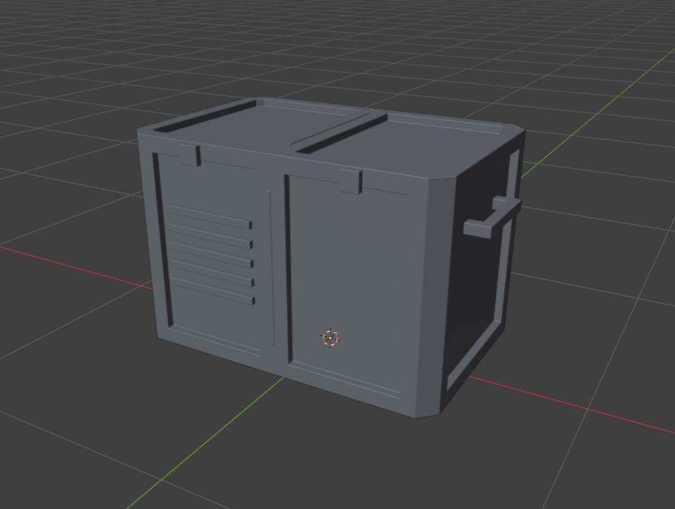
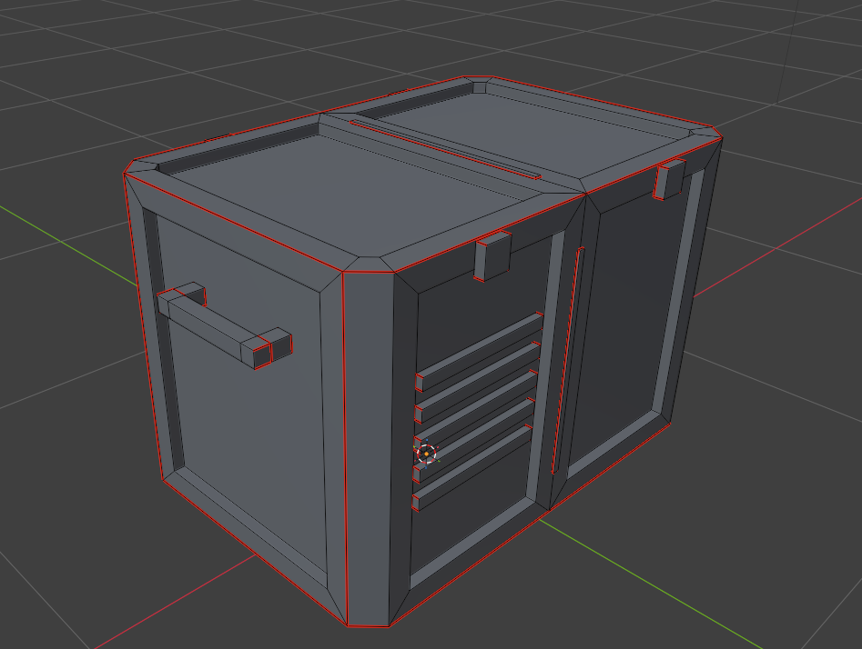
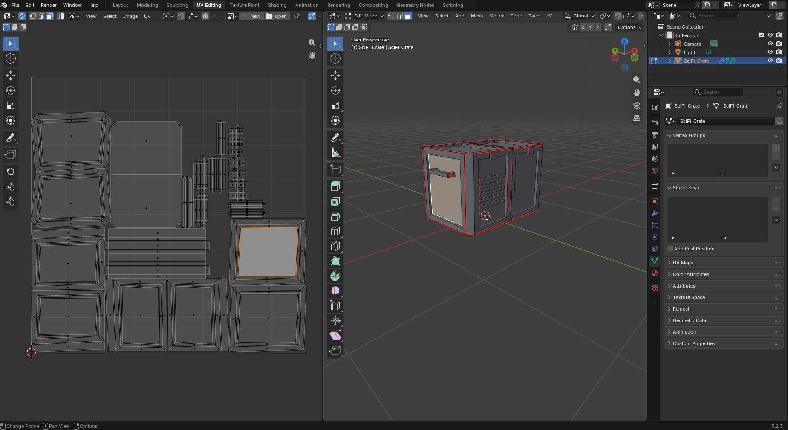
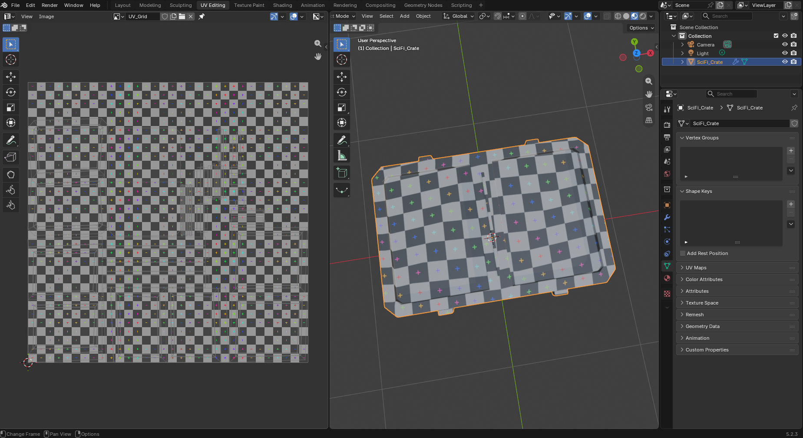
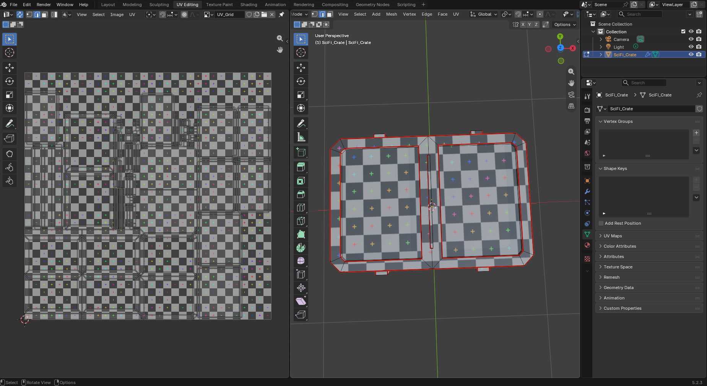
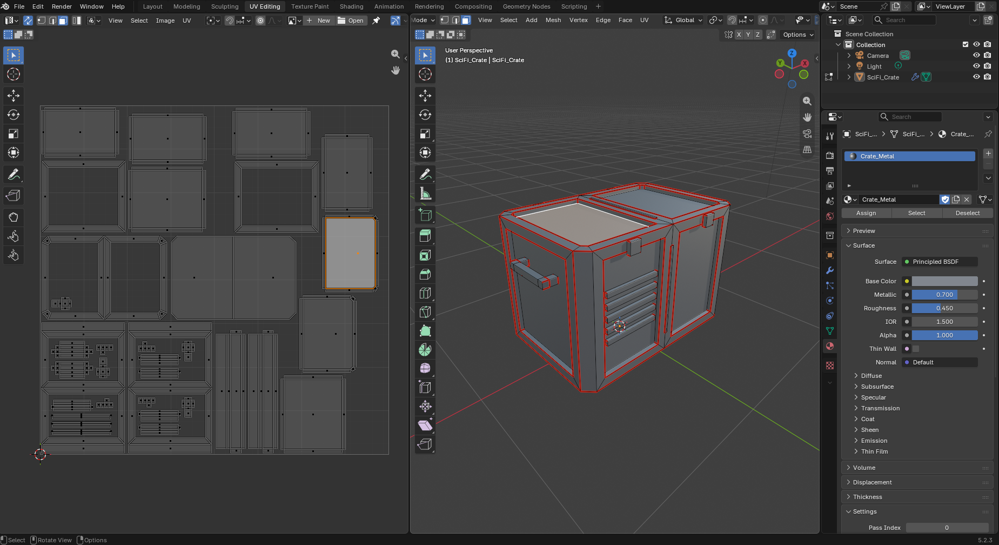
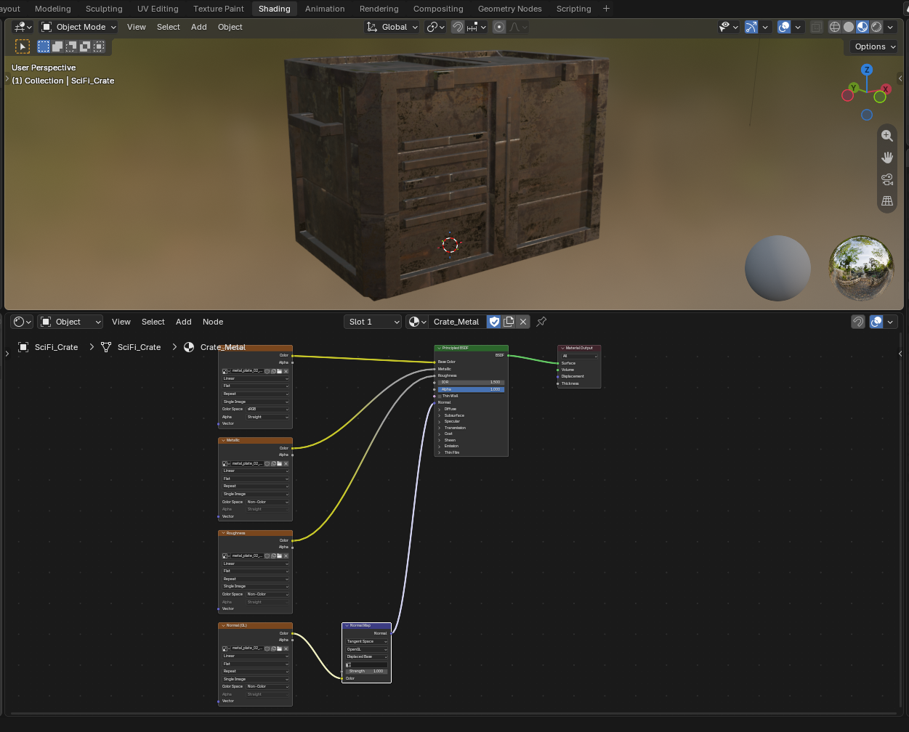
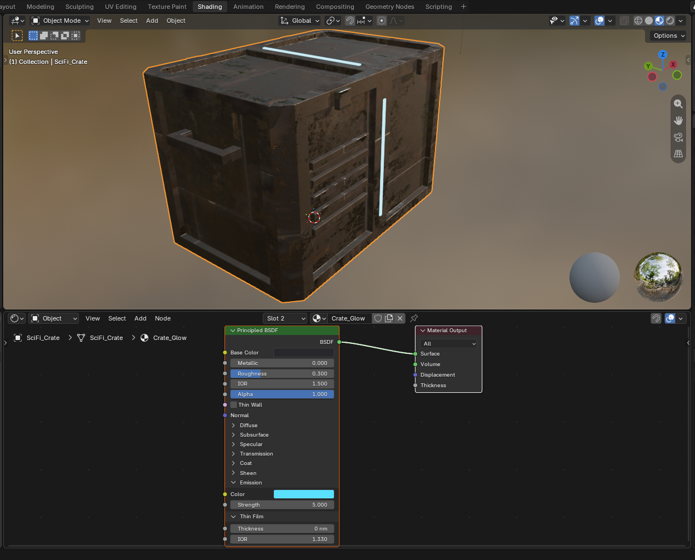
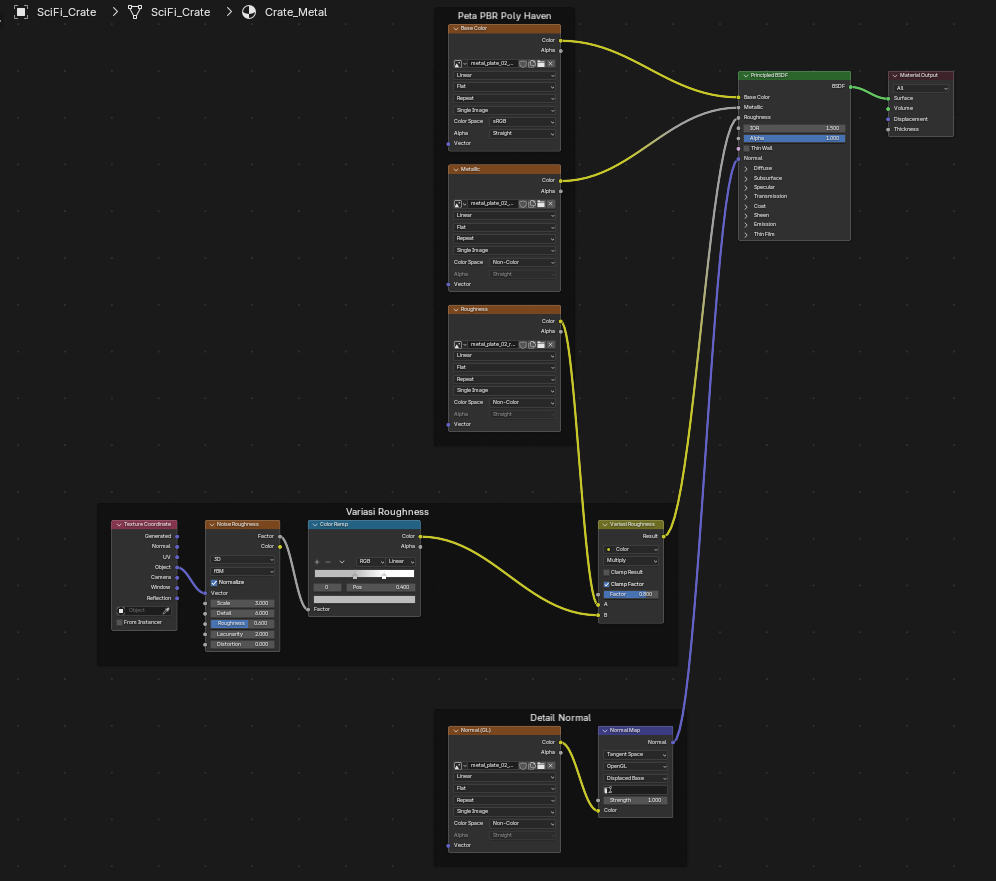
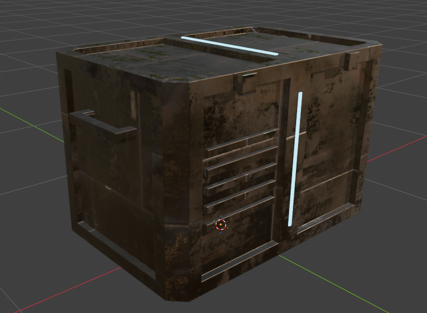

# UV Mapping & Material PBR: Sci-Fi Crate

Praktikum Grafika Komputer Pertemuan 10: UV mapping dan material PBR di Blender untuk Sci-Fi Crate.

## Identitas

- Kelompok: `Tim Unrendered` (Kelompok 9) — Kelas `Grafika Komputer (B)`
- Anggota:
  - `Randi Palguna Artayasa` — `5025231020`
  - `Hikmia Sofia Nur Izzati` — `5025231147`

## Ringkasan

| Poin | Isi |
| --- | --- |
| File | `P10_Kelompok9_SciFiCrate.blend`, texture di `textures/` dengan path relatif |
| Seam | Tepi atas, tepi bawah, dan 4 sudut tegak badan; tiap bagian kecil dibuka seperti kardus; tepi dan sudut dinding panel cekung |
| UV island | 34 island, tidak ada overlap |
| Distorsi | Checker melar di panel cekung, diperbaiki dengan seam panel lalu unwrap ulang |
| Texel density | Average Islands Scale, lalu Pack Islands margin 0.01 (sekitar 6 px/cm untuk texture 2K) |
| Logam / non-logam | Badan logam dari Metallic map, garis lampu non-logam (Metallic 0) |
| Emission | Garis lampu memakai material kedua `Crate_Glow`, Emission Strength 5 |
| Normal | Goresan dan lekukan kecil dari normal map lewat Normal Map node |
| Challenge | Multi-material surface; Custom roughness variation (Noise Texture dikali roughness map) |

## Texture

Metal Plate 02 oleh Rob Tuytel dari [Poly Haven](https://polyhaven.com/a/metal_plate_02), lisensi CC0.

| File | Input | Color space |
| --- | --- | --- |
| `metal_plate_02_diff_2k.jpg` | Base Color | sRGB |
| `metal_plate_02_rough_2k.jpg` | Roughness | Non-Color |
| `metal_plate_02_metal_2k.jpg` | Metallic | Non-Color |
| `metal_plate_02_nor_gl_2k.jpg` | Normal, lewat Normal Map node | Non-Color |

## Screenshot

| Sebelum UV | Seam |
| --- | --- |
|  |  |
| **Unwrap awal** | **Checker sebelum perbaikan** |
|  |  |
| **Checker sesudah perbaikan** | **UV final** |
|  |  |
| **Node graph Crate_Metal** | **Emission** |
|  |  |
| **Node graph final** | **Hasil akhir** |
|  |  |

## Kendala dan solusi

| Kendala | Solusi |
| --- | --- |
| Checker melar di sekitar panel cekung | Seam di tepi dan sudut dinding panel, lalu unwrap ulang |

## Tugas Tambahan: Eksplorasi PBR Material

<!-- Lanjut isi bagian tugas tambahan disini -->
