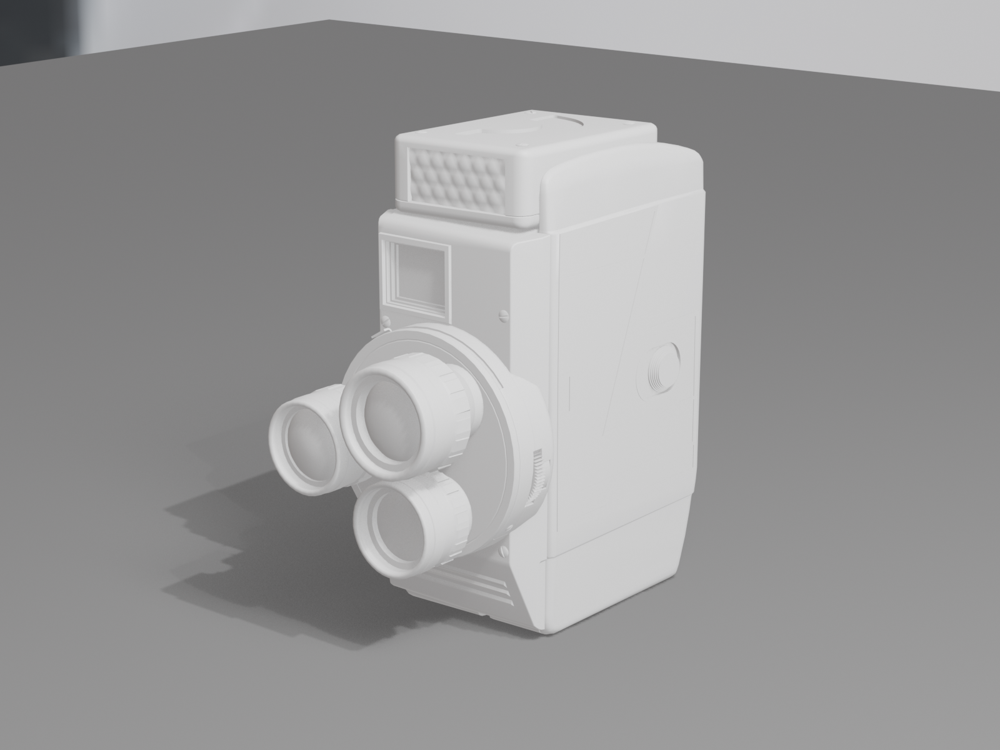
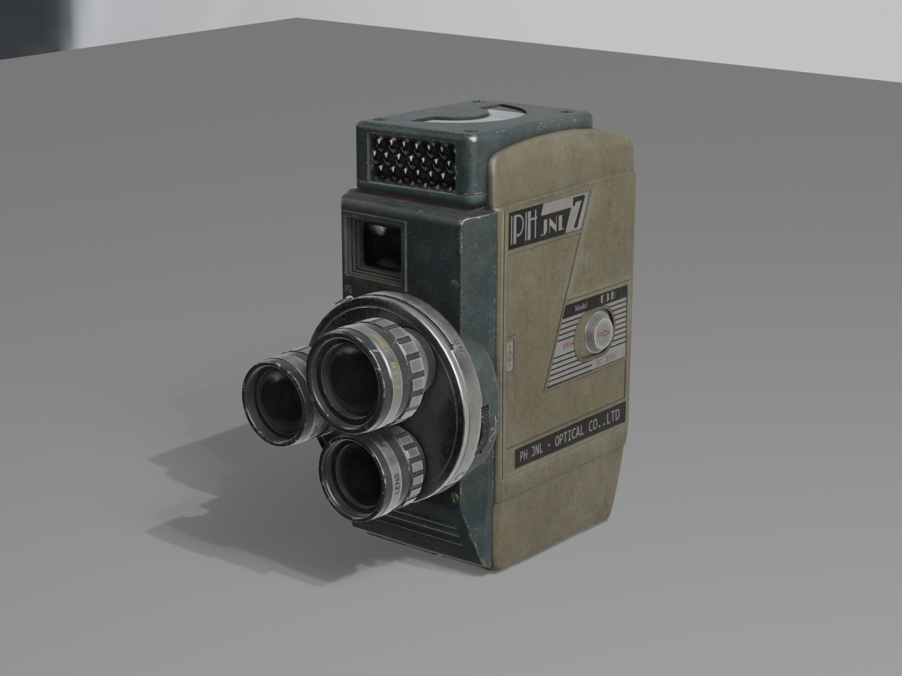
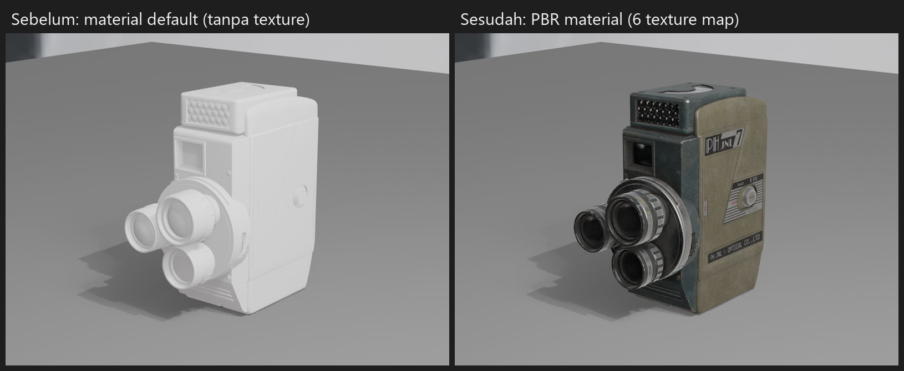
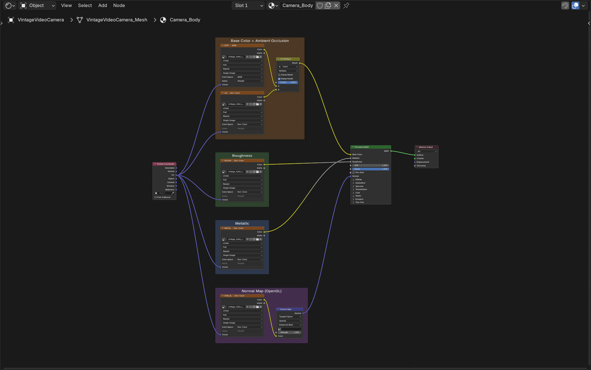
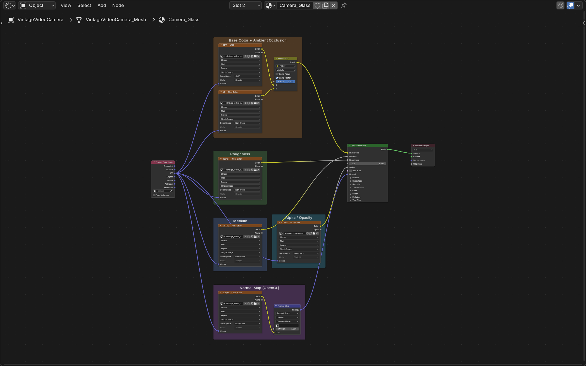
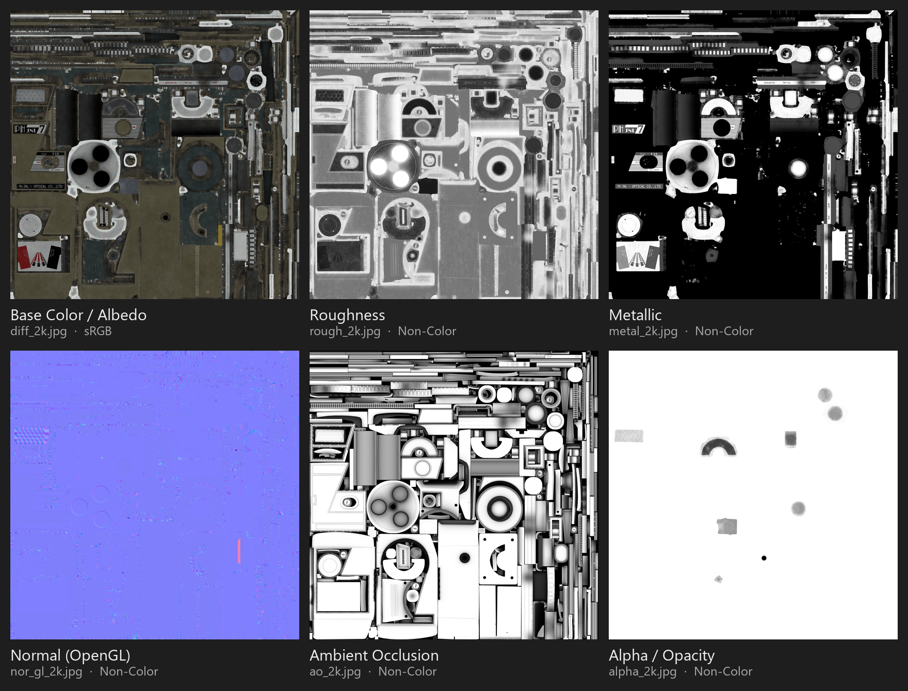
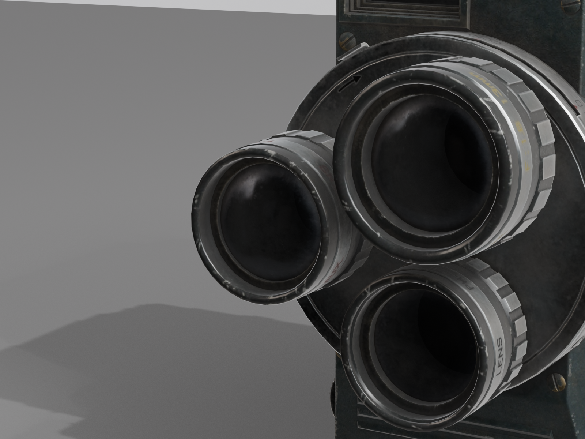

# UV Mapping & Material PBR: Sci-Fi Crate

Praktikum Grafika Komputer Pertemuan 10: UV mapping dan material PBR di Blender untuk Sci-Fi Crate.

## Identitas

- Kelompok: `Tim Unrendered` (Kelompok 9) — Kelas `Grafika Komputer (B)`
- Anggota:
  - `Randi Palguna Artayasa` — `5025231020`
  - `Hikmia Sofia Nur Izzati` — `5025231147`

## Ringkasan

| Poin | Isi |
| --- | --- |
| File | `P10_Kelompok9_SciFiCrate.blend`, texture di `textures/` dengan path relatif |
| Seam | Tepi atas, tepi bawah, dan 4 sudut tegak badan; tiap bagian kecil dibuka seperti kardus; tepi dan sudut dinding panel cekung |
| UV island | 34 island, tidak ada overlap |
| Distorsi | Checker melar di panel cekung, diperbaiki dengan seam panel lalu unwrap ulang |
| Texel density | Average Islands Scale, lalu Pack Islands margin 0.01 (sekitar 6 px/cm untuk texture 2K) |
| Logam / non-logam | Badan logam dari Metallic map, garis lampu non-logam (Metallic 0) |
| Emission | Garis lampu memakai material kedua `Crate_Glow`, Emission Strength 5 |
| Normal | Goresan dan lekukan kecil dari normal map lewat Normal Map node |
| Challenge | Multi-material surface; Custom roughness variation (Noise Texture dikali roughness map) |

## Texture

Metal Plate 02 oleh Rob Tuytel dari [Poly Haven](https://polyhaven.com/a/metal_plate_02), lisensi CC0.

| File | Input | Color space |
| --- | --- | --- |
| `metal_plate_02_diff_2k.jpg` | Base Color | sRGB |
| `metal_plate_02_rough_2k.jpg` | Roughness | Non-Color |
| `metal_plate_02_metal_2k.jpg` | Metallic | Non-Color |
| `metal_plate_02_nor_gl_2k.jpg` | Normal, lewat Normal Map node | Non-Color |

## Screenshot

| Sebelum UV | Seam |
| --- | --- |
|  |  |
| **Unwrap awal** | **Checker sebelum perbaikan** |
|  |  |
| **Checker sesudah perbaikan** | **UV final** |
|  |  |
| **Node graph Crate_Metal** | **Emission** |
|  |  |
| **Node graph final** | **Hasil akhir** |
|  |  |

## Kendala dan solusi

| Kendala | Solusi |
| --- | --- |
| Checker melar di sekitar panel cekung | Seam di tepi dan sudut dinding panel, lalu unwrap ulang |

## Tugas Tambahan: Eksplorasi PBR Material

Semua file ada di folder [`tugas-tambahan/`](tugas-tambahan):

```
tugas-tambahan/
├── P10_Kelompok9_VintageVideoCamera.blend
├── textures/      6 texture map + 1 HDRI, path relatif
└── screenshots/   sebelum/sesudah, node graph, texture map, close-up
```

### Asset

| Poin | Isi |
| --- | --- |
| Model | Vintage Video Camera: kamera film era Perang Dunia II dengan turret tiga lensa dan logam yang aus |
| Sumber | [Poly Haven: Vintage Video Camera](https://polyhaven.com/a/vintage_video_camera) |
| Pembuat | Jenelle van Heerden (foto dan model), James Ray Cock (texture) |
| Lisensi | [CC0 1.0](https://polyhaven.com/license): domain publik, bebas dipakai untuk belajar maupun komersial tanpa atribusi |
| Format yang dipakai | FBX 2K (geometry saja) dan texture JPG 2K |
| Geometry | 1 object, 10.299 face, ukuran asli 7,1 × 13,3 × 14,5 cm, scale 1 |
| Material | 2 slot: `Camera_Body` (9.212 face) dan `Camera_Glass` (1.087 face, kaca lensa) |
| Lighting | HDRI [Studio Small 09](https://polyhaven.com/a/studio_small_09) (CC0) dan satu Area Light |

### Texture map

| File | Map | Input Principled BSDF | Color space |
| --- | --- | --- | --- |
| `vintage_video_camera_diff_2k.jpg` | Base Color / Albedo | Base Color, lewat Mix Multiply dengan AO | sRGB |
| `vintage_video_camera_ao_2k.jpg` | Ambient Occlusion | Input B pada Mix Multiply | Non-Color |
| `vintage_video_camera_rough_2k.jpg` | Roughness | Roughness | Non-Color |
| `vintage_video_camera_metal_2k.jpg` | Metallic | Metallic | Non-Color |
| `vintage_video_camera_nor_gl_2k.jpg` | Normal (OpenGL) | Normal, lewat Normal Map node (Tangent Space) | Non-Color |
| `vintage_video_camera_alpha_2k.jpg` | Alpha / Opacity | Alpha, hanya di `Camera_Glass` | Non-Color |

Map yang tersedia di Poly Haven tapi tidak dipakai:

- `arm`: gabungan AO, Roughness, dan Metallic dalam satu file. Isinya sama dengan tiga map terpisah di atas.
- `nor_dx`: normal map versi DirectX. Blender memakai konvensi OpenGL.
- `disp`: displacement. Detail permukaan sudah cukup dari normal map.

### Cara menghubungkan

1. FBX di-import, lalu material bawaannya dihapus karena path texture-nya menunjuk ke folder yang tidak ada. Model dirender dengan material default sebagai kondisi **sebelum**.
2. Material `Camera_Body` dan `Camera_Glass` dibuat dari nol dengan Principled BSDF. Semua Image Texture memakai output `UV` dari Texture Coordinate.
3. Base Color dikalikan dengan AO lewat node Mix mode Multiply (Factor 1). Principled BSDF tidak punya input AO, jadi AO dipakai untuk menggelapkan celah di Base Color.
4. Roughness dan Metallic langsung masuk ke input masing-masing. Map ini berisi data, bukan warna, jadi color space-nya Non-Color.
5. Normal map masuk ke **Normal Map node** dulu, baru ke input Normal. Kalau langsung disambungkan, BSDF akan membaca nilai warna sebagai arah normal dan shading jadi rusak.
6. Di `Camera_Glass`, Alpha map masuk ke input Alpha dan Render Method diset ke `Blended`. Hasilnya kaca lensa jadi semi-transparan.
7. Node dikelompokkan dengan Frame berwarna: Base Color + AO, Roughness, Metallic, Normal Map, dan Alpha.
8. `File → External Data → Make Paths Relative`, lalu path diubah ke `//textures/...`. File `.blend` dan folder `textures/` sudah dicoba disalin ke folder lain dan dibuka di Blender: tidak ada texture yang missing.

### Hasil

| Sebelum PBR | Sesudah PBR |
| --- | --- |
|  |  |



Perbedaan yang terlihat setelah PBR diterapkan:

- **Base Color**: badan hijau-zaitun, panel depan biru-gelap, dan label "PH JNL 7" serta "OPTICAL CO. LTD" muncul. Sebelumnya semua putih polos.
- **Metallic**: cincin lensa dan sekrup memantulkan HDRI seperti logam. Cat badan tetap non-logam.
- **Roughness**: bagian logam yang aus lebih mengilap dibanding cat yang doff, jadi highlight tidak rata di seluruh permukaan.
- **Normal**: goresan, ulir cincin lensa, dan lekukan kecil terlihat tanpa menambah polygon.
- **AO**: celah antar panel dan sekitar lensa lebih gelap, jadi bentuknya lebih terbaca.
- **Alpha**: kaca lensa semi-transparan sehingga bagian dalam lensa terlihat.

| Node graph `Camera_Body` | Node graph `Camera_Glass` |
| --- | --- |
|  |  |

| Texture map | Close-up lensa |
| --- | --- |
|  |  |

### Kendala dan solusi (tugas tambahan)

| Kendala | Solusi |
| --- | --- |
| Setelah import, material FBX menunjuk ke texture yang tidak ada (`.png` / `.exr` di folder lain) | Material bawaan dihapus, lalu node dibangun ulang dengan texture JPG di `textures/` |
| Setelah material dihapus, semua face kaca ikut pindah ke slot pertama | Material index tiap face kaca dipulihkan dari data FBX asli |
| Path texture tersimpan absolut, jadi akan missing di komputer lain | `Make Paths Relative`, lalu diuji dengan menyalin folder ke lokasi lain |
| Kaca lensa tampak buram dan solid | Alpha map dihubungkan ke input Alpha dengan Render Method `Blended` |
